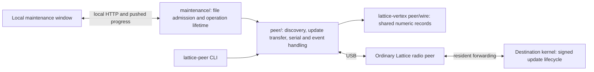

# Lattice tools

A computer and USB radio participate as one ordinary Lattice peer. This repository
owns the reusable Linux peer client and a local firmware maintenance interface.
The receiving vertex owns package authorization, flash staging, activation timing,
startup confirmation and recovery. No router, Internet service, tablet or nucleus
is required for a transfer; obtain the release file separately.

## Run

```sh
cargo +stable run --locked -p lattice-maintenance -- /dev/serial/by-id/YOUR_RADIO
```

Open the printed `http://127.0.0.1:8765` address. Discover the network, select a
responding vertex, drop its `.lvup` file and choose **Send update**. An optional
second argument changes the local HTTP port. The interface binds only to loopback;
it does not start a server on the radio, enable MCU Wi-Fi, or change host networking.
The connected MCU must run Lattice's host-v4 companion endpoint. An ordinary UART
adapter or an unrelated Zigbee stack is not that endpoint.

Each package contains a complete appliance/kernel image. Shared appliance releases
can apply to multiple compatible vertices; custom firmware can require a distinct
package. This client sends to one selected vertex. Serving retained images between
vertices remains future kernel work.

Discovery walks resident link references on demand, up to 32 remote vertices in
the UI. It reports partial walks and permits another discovery. It does not retain
an authoritative network inventory. The attached radio is identified separately
and cannot be selected for replacement through this window.

The client checks package length and image digest; the destination verifies the
signature, target, release version and surface compatibility. The UI requires
measured costs for autonomous activation. Re-offering the same file resumes the
receiver's progress. Busy requests use bounded backoff; delivery failures have
bounded retries. These retries never apply to native transformer invocation.

**Verified at the vertex means staged and verified.** The current remote update
reply does not report the running release after reboot. The UI does not claim an
image booted or confirmed from transfer completion, and does not send a remote
activation/reset command. Local port fixtures can independently check startup.

The server retains one active operation and streams browser progress with SSE.
It rejects concurrent operations rather than retaining a background job queue.
Browser progress reads no radio state. Ordinary pushed changes are drained during
upload; buffer-loss counts remain distinct from RF loss. Closing the browser
does not cancel the process's transfer; stopping the process closes USB and a
subsequent offer resumes from receiver progress.

## Ownership



`peer/` is independent of the browser and tablet presentation. Its serial transport,
event demultiplexing, surface reader and original CLI were extracted from
`lattice-tablet/peer`; discovery and update supply live here. The tablet currently
retains its previous client. Replacing that copy with a pinned dependency on this
crate is a separate migration. Both consumers use the kernel's shared wire crate;
this library is the intended shared owner of host transport and peer operations.

The wire dependency is pinned to kernel commit
`8b57885ac83353fb416c157dcd5ea108b1dcc5ad` (LVT v7, host v4, Verifying phase).
There is no build dependency on a neighboring checkout or local lab directory.
The first host port is Linux. Other desktop platforms need their own serial I/O
port, without moving discovery or transfer policy into the UI.

## Checks

```sh
cargo +stable test --workspace --locked
cargo +stable clippy --workspace --all-targets --locked -- -D warnings
```

Portable checks cover surface completeness, interleaved events, overflow notices,
update reply correlation and package integrity. Hardware and browser results are
recorded below after exercising the actual companion and receiving kernel.

On 2026-10-18, the browser completed discovery, an actual file-drop event and signed
transfer with both MCU roles. Nordic was `66279731b172d64c`; C6 was
`9ecc01fffe406798`.

| Computer's USB peer | Receiving vertex | Image bytes | Result |
| --- | --- | ---: | --- |
| C6 | Nordic | 132,228 | Release 3 activated and retained after reset |
| Nordic | C6 | 292,208 | Release 3 activated and retained after reset |

Each receiver verified the image and activated autonomously. Another reset without
host confirmation retained release 3. Boot retention was checked independently
through the destination's diagnostic USB port, not inferred by the browser. The
reverse test required no client, driver or protocol changes; only the USB source,
destination and target-specific package changed. Both were one-hop, empty-appliance
fixture checks; they do not establish multi-hop hardware delivery or physical
appliance behavior. Existing dry-run coefficients exercised pacing, not new release
timing certification. Desktop and 390-pixel browser layouts passed with no
JavaScript errors. Requests lacking the local session token were rejected.
